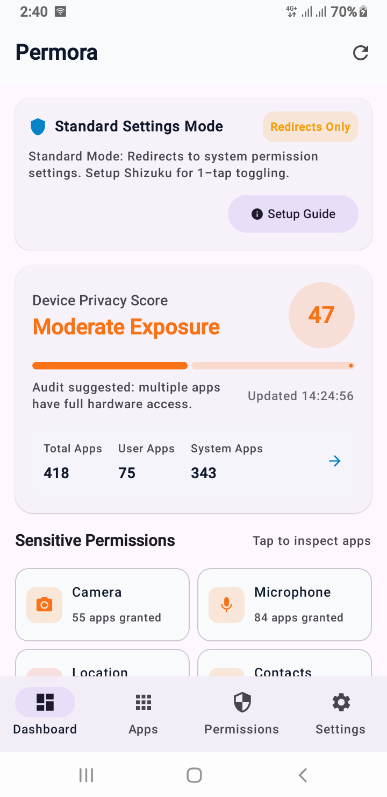

# Permora - One-Place Android Permission Manager

**Permora** is a complete, production-quality Android application that gives users full visibility and granular control over app permissions, background sensor access, and system-level privileges.

---

## 🎬 App Demo

  

*Click the screenshot above to watch the app in action on YouTube.*

---

## Features

1. **Dashboard & Privacy Score**
   - Live audit score (0–100) reflecting device privacy health based on sensitive permissions granted.
   - Real-time tally for sensitive permission categories: Camera, Microphone, Location, Contacts, SMS, Call Log, Storage, Phone, Calendar, Body Sensors, Nearby Devices, and Notifications.
   - Quick breakdown of User vs. System installed apps.
   - Top high-risk apps card with instant navigation to inspect.

2. **App Inventory & Filter System**
   - Fast, cached app list powered by Room and Kotlin Coroutines.
   - Filter by: User Apps, System Apps, Risky Apps, All Apps.
   - Sort by: Risk Level, Permission Count, Name (A-Z), Name (Z-A).
   - Real-time search query matching app name and package ID.
   - Multi-select mode for batch operations.

3. **Detailed App Inspector**
   - Inspect every permission declared by any application.
   - Grouped by official Android permission groups.
   - Plain-language risk assessments (Critical, High, Medium, Low) and descriptions.
   - Individual switches to toggle permissions.
   - Deep links into system App Info and special access management.

4. **Permission-Centric Explorer**
   - Select any permission (e.g., Location or Microphone) to see every app with active access.
   - Bulk revocation capability across all apps holding that permission.

5. **Permission Usage Timeline (AppOps)**
   - Historical audit log showing which apps accessed sensitive capabilities and when.

6. **Revoke All & Undo Engine**
   - "Revoke All Permissions" for any individual app or selected batch.
   - Automatic snapshot stored in Room database before revocation.
   - Undo snackbar allows restoring previous permission states with a single tap.

7. **Special Access Management**
   - Audit system-level capabilities: Display over other apps (Overlay), Usage Data Access, Install Unknown Apps, Notification Listener, All Files Access, and Ignore Battery Optimizations.
   - One-tap intent redirection to the corresponding Android Settings screen.

8. **Live Package Listener**
   - `PackageChangeReceiver` listens for package addition, removal, and replacement broadcasts to keep the cache automatically updated without requiring full rescans.

9. **Security Audit Export**
   - Export structured reports in JSON or CSV format using the Android Storage Access Framework (`CreateDocument`).

10. **Dual-Mode Permission Control**
    - **Privileged Mode (Shizuku)**: Executes `pm grant`, `pm revoke`, and AppOps via Shizuku binder. Provides instant 1-tap toggles without root or leaving the app.
    - **Standard Redirect Mode**: Graceful fallback when Shizuku is not running; deep-links directly to Android Settings and re-evaluates state automatically upon return (`ON_RESUME`).

11. **100% Private & Local**
    - Zero network permissions (`INTERNET` permission is absent from `AndroidManifest.xml`).
    - Zero analytics, trackers, or external telemetry.

---

## How to Set Up Shizuku (Privileged Mode)

Shizuku provides elevated Android shell privileges without needing root access:

1. **Install Shizuku**:
   Download the [Shizuku app](https://shizuku.rikka.app) from GitHub or Google Play Store.
2. **Enable Developer Options**:
   Open **Settings > About Phone** and tap **Build Number** 7 times.
3. **Start Shizuku via Wireless Debugging (Android 11+)**:
   - Go to **Settings > System > Developer Options > Wireless Debugging** and toggle it **On**.
   - Tap **Pair device with pairing code**.
   - Enter the 6-digit code in the Shizuku pairing notification.
   - In the Shizuku app, tap **Start**.
4. **Authorize Permora**:
   - Open Permora.
   - Tap **Authorize Shizuku** on the banner or in **Settings > Privileged Mode**.
   - Enjoy instant 1-tap grant and revoke controls!

---

## Architecture & Tech Stack

- **Architecture**: Clean Architecture + MVVM + UDF (Unidirectional Data Flow)
- **UI**: Jetpack Compose, Material 3, Dynamic Color (Material You), Adaptive layouts
- **Language**: Kotlin 2.x
- **Persistence**: Jetpack Room, DataStore Preferences
- **Privilege Engine**: Rikka Shizuku API
- **Background Work**: AndroidX WorkManager (`ScanAppsWorker`)
- **Image Loading**: Coil
- **Logging**: Timber
